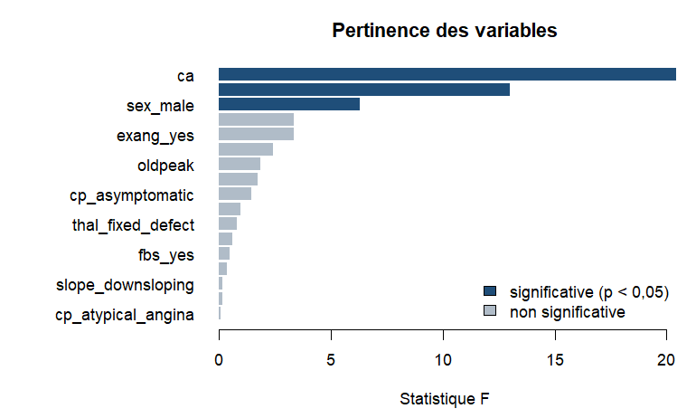

## 1. Contexte, objectif et données

Le jeu `heart_disease` (base de Cleveland, UCI Machine Learning Repository,
licence CC BY 4.0) décrit 303 patients qui ont passé une
coronarographie. L'objectif est de **prédire la présence d'une maladie
cardiaque** (variable `disease`, valeurs `no` / `yes`) à partir de
13 variables cliniques, avec la classe `ADL` du
package `adlSISE` (analyse discriminante linéaire prédictive).

Les variables explicatives sont :

| Variable | Type | Signification |
|---|---|---|
| `age` | numérique | âge en années |
| `sex` | qualitative | `female` / `male` |
| `cp` | qualitative | type de douleur thoracique |
| `trestbps` | numérique | pression artérielle au repos (mm Hg) |
| `chol` | numérique | cholestérol sérique (mg/dl) |
| `fbs` | qualitative | glycémie à jeun > 120 mg/dl |
| `restecg` | qualitative | électrocardiogramme au repos |
| `thalach` | numérique | fréquence cardiaque maximale atteinte |
| `exang` | qualitative | angine induite par l'effort |
| `oldpeak` | numérique | sous-décalage du segment ST à l'effort |
| `slope` | qualitative | pente du segment ST à l'effort |
| `ca` | numérique | nombre de gros vaisseaux colorés (0 à 3) |
| `thal` | qualitative | résultat de la scintigraphie au thallium |


``` r
# structure du jeu brut
str(heart_disease)
```

```
#> 'data.frame':	303 obs. of  14 variables:
#>  $ age     : num  63 67 67 37 41 56 62 57 63 53 ...
#>  $ sex     : Factor w/ 2 levels "female","male": 2 2 2 2 1 2 1 1 2 2 ...
#>  $ cp      : Factor w/ 4 levels "typical_angina",..: 1 4 4 3 2 2 4 4 4 4 ...
#>  $ trestbps: num  145 160 120 130 130 120 140 120 130 140 ...
#>  $ chol    : num  233 286 229 250 204 236 268 354 254 203 ...
#>  $ fbs     : Factor w/ 2 levels "no","yes": 2 1 1 1 1 1 1 1 1 2 ...
#>  $ restecg : Factor w/ 3 levels "normal","st_t_abnormality",..: 3 3 3 1 3 1 3 1 3 3 ...
#>  $ thalach : num  150 108 129 187 172 178 160 163 147 155 ...
#>  $ exang   : Factor w/ 2 levels "no","yes": 1 2 2 1 1 1 1 2 1 2 ...
#>  $ oldpeak : num  2.3 1.5 2.6 3.5 1.4 0.8 3.6 0.6 1.4 3.1 ...
#>  $ slope   : Factor w/ 3 levels "upsloping","flat",..: 3 2 2 3 1 1 3 1 2 3 ...
#>  $ ca      : num  0 3 2 0 0 0 2 0 1 0 ...
#>  $ thal    : Factor w/ 3 levels "normal","fixed_defect",..: 2 1 3 1 1 1 1 1 3 3 ...
#>  $ disease : Factor w/ 2 levels "no","yes": 1 2 2 1 1 1 2 1 2 2 ...
```

### Valeurs manquantes

`ADL` refuse les valeurs manquantes : on retire donc les lignes incomplètes
avec `na.omit()`.


``` r
manquantes <- colSums(is.na(heart_disease))
manquantes[manquantes > 0]
```

```
#>   ca thal 
#>    4    2
```

``` r
coeur <- na.omit(heart_disease)
```

Les 6 valeurs manquantes (variables `ca` et `thal`)
touchent 6 lignes, qui sont retirées : il
reste **297 patients**, soit
2,0 % de données en
moins. C'est peu, mais ce choix suppose que les données manquent « au hasard ».

### Une modalité très rare


``` r
table(coeur$restecg, coeur$disease)
```

```
#>                   
#>                    no yes
#>   normal           92  55
#>   st_t_abnormality  1   3
#>   lv_hypertrophy   67  79
```

La modalité `st_t_abnormality` de `restecg` ne compte que
4 patients. Une modalité aussi rare
est dangereuse pour `ADL` : si elle est absente d'un échantillon
d'apprentissage (ou si elle n'y apparaît que dans une classe), sa colonne
indicatrice est constante et la matrice de covariance intra-classes n'est plus
inversible. On **regroupe** donc les deux modalités anormales de `restecg` en
une seule (`abnormal`) ; `normal` devient la modalité de référence. C'est un
choix de cette étude de cas, pas une propriété du jeu ; la section 3 vérifie
ce qui se passerait sans ce regroupement.


``` r
# on garde la variable d'origine pour la vérification de la section 3
restecg_origine <- coeur$restecg
```


``` r
coeur$restecg <- factor(ifelse(coeur$restecg == "normal", "normal", "abnormal"),
                        levels = c("normal", "abnormal"))
table(coeur$disease)
```

```
#> 
#>  no yes 
#> 160 137
```

La cible est assez équilibrée : 46,1 % de
patients malades.

## 2. Découpage apprentissage / test

On réserve 30 % des patients pour le test, en tirant séparément dans chaque
classe (découpage **stratifié**) pour conserver les proportions. La graine est
fixée pour que le résultat soit reproductible.


``` r
set.seed(2024)
# 30 % de chaque classe va dans l'échantillon de test (R de base)
indices_test <- unlist(lapply(split(seq_len(nrow(coeur)), coeur$disease),
                              function(i) sample(i, size = round(0.3 * length(i)))))
test <- coeur[indices_test, ]
app  <- coeur[-indices_test, ]

variables <- setdiff(names(coeur), "disease")
X_app <- app[, variables];  y_app <- app$disease
X_test <- test[, variables]; y_test <- test$disease

knitr::kable(rbind(Apprentissage = table(y_app), Test = table(y_test)))
```


|              |  no| yes|
|:-------------|---:|---:|
|Apprentissage | 112|  96|
|Test          |  48|  41|

L'apprentissage compte 208 patients et le test 89.

## 3. Trois modèles ADL

On compare un modèle sans sélection de variables et deux modèles avec
sélection pas à pas (forward et backward, seuil alpha = 0,05). Pour chaque
modèle, on calcule :

- le taux d'erreur sur le **test** ;
- le taux d'erreur de **resubstitution** (sur l'apprentissage) ;
- le taux d'erreur par **validation croisée** à 5 plis sur l'apprentissage
  (la sélection de variables est refaite dans chaque pli).

### Que se passe-t-il sans le regroupement de `restecg` ?

On refait le modèle complet sur l'apprentissage avec les trois modalités
d'origine de `restecg`, puis une validation croisée à 5 plis :


``` r
X_essai <- X_app
X_essai$restecg <- droplevels(restecg_origine[-indices_test])
essai <- tryCatch({
  m_essai <- ADL$new()$fit(X_essai, y_app)
  m_essai$cross_validate(X_essai, y_app, folds = 5, seed = 1)$error
}, error = function(e) conditionMessage(e))
essai
```

```
#> [1] "La matrice W n'est pas inversible : variables constantes ou colineaires."
```

Le calcul échoue avec le message : « La matrice W n'est pas inversible : variables constantes ou colineaires. ». Le regroupement est donc nécessaire pour ce découpage.

### Comparaison des trois modèles


``` r
specs <- c("Sans sélection" = "none", "Forward" = "forward", "Backward" = "backward")

# un modèle par méthode, appris sur l'échantillon d'apprentissage
modeles <- lapply(specs, function(s) {
  ADL$new(priors = "proportional", selection = s, alpha = 0.05)$fit(X_app, y_app)
})

taux_err <- function(cm) 1 - sum(diag(cm)) / sum(cm)

comparaison <- data.frame(
  Modèle = names(modeles),
  `Nb de variables retenues` = sapply(modeles, function(m) length(m$selected_variables)),
  `Erreur test` = sapply(modeles, function(m) mean(m$predict(X_test) != y_test)),
  `Erreur resubstitution` = sapply(modeles, function(m) taux_err(m$confusion)),
  `Erreur validation croisée` = sapply(modeles, function(m)
    m$cross_validate(X_app, y_app, folds = 5, seed = 1)$error),
  check.names = FALSE, row.names = NULL)

knitr::kable(comparaison, digits = 4)
```


|Modèle         | Nb de variables retenues| Erreur test| Erreur resubstitution| Erreur validation croisée|
|:--------------|------------------------:|-----------:|---------------------:|-------------------------:|
|Sans sélection |                       17|      0.1011|                0.1490|                    0.2019|
|Forward        |                        7|      0.1011|                0.1683|                    0.2306|
|Backward       |                        7|      0.1011|                0.1683|                    0.2307|

Variables retenues par chaque modèle (après recodage des qualitatives en
indicatrices 0/1) :


``` r
for (nom in names(modeles)) {
  cat(nom, ":", paste(modeles[[nom]]$selected_variables, collapse = ", "), "\n\n")
}
```

```
#> Sans sélection : age, sex_male, cp_atypical_angina, cp_non_anginal, cp_asymptomatic, trestbps, chol, fbs_yes, restecg_abnormal, thalach, exang_yes, oldpeak, slope_flat, slope_downsloping, ca, thal_fixed_defect, thal_reversible_defect 
#> 
#> Forward : thal_reversible_defect, ca, exang_yes, cp_asymptomatic, slope_flat, sex_male, thalach 
#> 
#> Backward : sex_male, cp_asymptomatic, thalach, exang_yes, slope_flat, ca, thal_reversible_defect
```

Sur le test, les trois modèles ont le même taux d'erreur
(10,1 % pour le modèle sans sélection,
10,1 % pour forward et
10,1 % pour backward) : le test, avec ses
89 patients, ne permet pas de les départager. Choisir le « meilleur
modèle » sur l'erreur de test serait d'ailleurs une faute (on utiliserait le
test pour choisir, il ne serait plus indépendant). On choisit donc d'après
l'**erreur de validation croisée**, calculée sur l'apprentissage uniquement ; à
égalité, on prend le modèle qui retient le moins de variables.


``` r
ordre <- order(round(comparaison[["Erreur validation croisée"]], 10),
               comparaison[["Nb de variables retenues"]])
nom_meilleur <- comparaison$Modèle[ordre[1]]
meilleur <- modeles[[nom_meilleur]]
nom_meilleur
```

```
#> [1] "Sans sélection"
```

Le modèle retenu est **« Sans sélection »**.

## 4. Évaluation du meilleur modèle sur le jeu de test


``` r
# matrice de confusion sur l'apprentissage : propriété $confusion
cm_app <- meilleur$confusion
# matrice de confusion sur le test : table() des classes observées et prédites
pred_test <- meilleur$predict(X_test)
cm_test <- table(observe = y_test, predit = pred_test)

cm_app
```

```
#>        predit
#> observe  no yes
#>     no  100  12
#>     yes  19  77
```

``` r
cm_test
```

```
#>        predit
#> observe no yes
#>     no  44   4
#>     yes  5  36
```

``` r
# sensibilité et spécificité sur le test ("yes" = malade = classe positive)
vp <- cm_test["yes", "yes"]; fn <- cm_test["yes", "no"]
vn <- cm_test["no", "no"];   fp <- cm_test["no", "yes"]
erreur_test <- (fp + fn) / sum(cm_test)
sensibilite <- vp / (vp + fn)
specificite <- vn / (vn + fp)
ic <- binom.test(fp + fn, sum(cm_test))$conf.int   # intervalle de confiance à 95 %
cv_meilleur <- meilleur$cross_validate(X_app, y_app, folds = 5, seed = 1)
```

(Lignes : classe observée ; colonnes : classe prédite.)

Sur le test, le taux d'erreur est de **10,1 %**
(9 erreurs sur 89 patients), avec une sensibilité de
87,8 % (36 malades sur 41 détectés) et une spécificité
de 91,7 % (44 sains sur 48 reconnus). Comme le test
est petit, cette estimation est imprécise : l'intervalle de confiance à 95 %
de l'erreur va de 4,7 % à 18,3 %.


``` r
knitr::kable(data.frame(
  Estimation = c("Resubstitution (apprentissage)", "Validation croisée 5 plis (apprentissage)",
                 "Test"),
  `Taux d'erreur` = c(taux_err(cm_app), cv_meilleur$error, erreur_test),
  check.names = FALSE), digits = 4)
```


|Estimation                                | Taux d'erreur|
|:-----------------------------------------|-------------:|
|Resubstitution (apprentissage)            |        0.1490|
|Validation croisée 5 plis (apprentissage) |        0.2019|
|Test                                      |        0.1011|

L'erreur de resubstitution (14,9 %) est **optimiste** : le
modèle est évalué sur les patients mêmes qui ont servi à estimer ses
coefficients, qui sont donc ajustés à leurs particularités (y compris au
hasard de l'échantillon). Un modèle qui apprend « par coeur » aurait une
erreur de resubstitution très basse sans généraliser. Elle ne mesure pas la
capacité à prédire de nouveaux patients, contrairement à la validation
croisée (chaque patient est prédit par un modèle qui ne l'a pas vu) et au
jeu de test.

Ici, l'erreur de resubstitution est effectivement plus basse que la
validation croisée (20,2 %). En revanche, l'erreur de test
(10,1 %) est **plus basse que les deux** : ce n'est pas
contradictoire. Avec 89 patients, l'erreur de test varie beaucoup
d'un découpage à l'autre (voir l'intervalle de confiance), et ce découpage-ci
a pu être favorable. La validation croisée, qui utilise tous les patients
d'apprentissage à tour de rôle, est une estimation plus stable : il serait
imprudent de prendre l'erreur de test seule pour la performance réelle.

## 5. Vérification avec `MASS::lda`

On vérifie que `adlSISE` donne les mêmes résultats que la référence `MASS::lda`
sur les mêmes données : mêmes variables (recodées en indicatrices avec
`Encodeur`, comme le fait `ADL`) et mêmes probabilités a priori
(proportions de l'apprentissage, valeur par défaut de `lda`).


``` r
# mêmes colonnes numériques que celles utilisées par ADL
enc <- Encodeur$new()
M_app  <- enc$fit_transform(X_app)
M_test <- enc$transform(X_test)
colonnes <- meilleur$selected_variables

ajust_lda <- MASS::lda(M_app[, colonnes, drop = FALSE], grouping = y_app)
pred_lda <- predict(ajust_lda, M_test[, colonnes, drop = FALSE])

proba_adl <- unname(meilleur$predict_proba(X_test))
ecart_proba <- max(abs(unname(pred_lda$posterior) - proba_adl))
memes_classes <- all(as.character(pred_lda$class) == as.character(pred_test))
ecart_proba
```

```
#> [1] 6.77236e-15
```

``` r
memes_classes
```

```
#> [1] TRUE
```

Sur les 89 patients du test, l'écart maximal entre les
probabilités a posteriori de `ADL` et de `lda` est de
6.77e-15 et les classes prédites sont
identiques pour tous les patients.

## 6. Interprétation

### Qualité globale : lambda de Wilks et F de Rao


``` r
w <- meilleur$wilks
unlist(w)
```

```
#>           lambda                F              df1              df2 
#>     4.804655e-01     1.208529e+01     1.700000e+01     1.900000e+02 
#>          p_value         bartlett      bartlett_df bartlett_p_value 
#>     3.053101e-22     1.447675e+02     1.700000e+01     2.576383e-22
```

Le lambda de Wilks du modèle « Sans sélection » vaut 0,4805 : plus
il est proche de 0, plus les classes sont séparées par les variables, plus il
est proche de 1, moins elles le sont. Le F de Rao vaut 12,09 avec
17 et 190,0 degrés de liberté
(p-value 3.05e-22), et le khi-deux de Bartlett
144,77 (p-value 2.58e-22) : les
classes « malade » et « sain » diffèrent de façon significative sur
l'ensemble des variables.

### Pertinence de chaque variable

Pour chaque variable, `$variable_tests` donne le lambda de Wilks du modèle
privé de la variable (`Wilks.L`), le lambda partiel (`Partial.L`, plus il est
petit, plus la variable apporte), la statistique F et sa p-value.


``` r
vt <- meilleur$variable_tests
knitr::kable(vt[order(-vt$F), ], digits = 4)
```


|                       | Wilks.L| Partial.L|       F| p.value|
|:----------------------|-------:|---------:|-------:|-------:|
|ca                     |  0.5321|    0.9029| 20.4276|  0.0000|
|thal_reversible_defect |  0.5133|    0.9360| 12.9942|  0.0004|
|sex_male               |  0.4964|    0.9679|  6.3103|  0.0128|
|thalach                |  0.4890|    0.9826|  3.3625|  0.0683|
|exang_yes              |  0.4889|    0.9827|  3.3388|  0.0692|
|slope_flat             |  0.4866|    0.9874|  2.4238|  0.1212|
|oldpeak                |  0.4852|    0.9903|  1.8628|  0.1739|
|trestbps               |  0.4848|    0.9910|  1.7186|  0.1915|
|cp_asymptomatic        |  0.4842|    0.9924|  1.4617|  0.2282|
|restecg_abnormal       |  0.4829|    0.9949|  0.9714|  0.3256|
|thal_fixed_defect      |  0.4825|    0.9957|  0.8143|  0.3680|
|age                    |  0.4819|    0.9969|  0.5865|  0.4447|
|fbs_yes                |  0.4817|    0.9974|  0.4871|  0.4861|
|cp_non_anginal         |  0.4813|    0.9982|  0.3485|  0.5557|
|slope_downsloping      |  0.4809|    0.9992|  0.1554|  0.6939|
|chol                   |  0.4808|    0.9992|  0.1501|  0.6988|
|cp_atypical_angina     |  0.4806|    0.9997|  0.0618|  0.8040|


``` r
# barres horizontales classées par F ; couleur selon la significativité
vt_ordre <- vt[order(vt$F), ]
couleurs <- ifelse(vt_ordre$p.value < 0.05, "#1f4e79", "#b0bcc8")
op <- par(mar = c(4.5, 11, 3, 1))
barplot(vt_ordre$F, names.arg = rownames(vt_ordre), horiz = TRUE, las = 1,
        col = couleurs, border = NA, xlab = "Statistique F",
        main = "Pertinence des variables")
legend("bottomright", bty = "n", fill = c("#1f4e79", "#b0bcc8"),
       legend = c("significative (p < 0,05)", "non significative"))
```



``` r
par(op)
```

Sur les 17 variables du modèle, 3 sont
significatives à 5 %. Les plus discriminantes (F le plus grand) sont
ca, thal_reversible_defect, sex_male. Ces tests
sont *partiels* : ils mesurent ce que chaque variable apporte **en plus des
autres**, donc deux variables corrélées peuvent paraître peu utiles alors
qu'elles le sont chacune isolément.

### Coefficients (fonctions de classement)

`$coefficients` contient une fonction de classement par classe : un patient est
affecté à la classe dont le score est le plus élevé. Comme les probabilités a
posteriori sont obtenues par softmax des scores, la **différence des
coefficients** « yes » − « no » est directement la contribution de la variable
au logarithme du rapport de chances (*odds*) de maladie.


``` r
coef <- meilleur$coefficients
tab_coef <- data.frame(no = coef[, "no"], yes = coef[, "yes"],
                       `yes - no` = coef[, "yes"] - coef[, "no"],
                       `odds ratio` = exp(coef[, "yes"] - coef[, "no"]),
                       check.names = FALSE)
knitr::kable(tab_coef, digits = 4)
```


|                       |        no|       yes| yes - no| odds ratio|
|:----------------------|---------:|---------:|--------:|----------:|
|constant               | -126.6520| -129.1367|  -2.4847|     0.0833|
|age                    |    0.9887|    0.9676|  -0.0210|     0.9792|
|sex_male               |    5.7177|    7.0465|   1.3288|     3.7765|
|cp_atypical_angina     |   21.1873|   21.4244|   0.2371|     1.2676|
|cp_non_anginal         |   22.6099|   22.0931|  -0.5168|     0.5964|
|cp_asymptomatic        |   26.1525|   27.2371|   1.0846|     2.9584|
|trestbps               |    0.4336|    0.4518|   0.0182|     1.0184|
|chol                   |    0.0366|    0.0383|   0.0017|     1.0017|
|fbs_yes                |   -2.6439|   -3.0863|  -0.4424|     0.6425|
|restecg_abnormal       |   -3.4116|   -2.9639|   0.4477|     1.5647|
|thalach                |    0.6780|    0.6547|  -0.0233|     0.9770|
|exang_yes              |    7.9970|    9.0064|   1.0093|     2.7438|
|oldpeak                |   -0.5274|   -0.2126|   0.3148|     1.3700|
|slope_flat             |   10.1163|   10.9227|   0.8065|     2.2400|
|slope_downsloping      |   11.3776|   10.9671|  -0.4105|     0.6633|
|ca                     |   -1.1820|   -0.0339|   1.1481|     3.1523|
|thal_fixed_defect      |    3.4347|    4.3396|   0.9049|     2.4716|
|thal_reversible_defect |   -1.4155|    0.4985|   1.9140|     6.7799|


**Lire une variable numérique.** Pour ca, la différence « yes − no » est
de 1,1481 : à valeurs égales des autres variables, une
unité de plus multiplie les chances de maladie par 3,152
(le signe indique le sens de l'effet). Les coefficients dépendent de l'unité
de la variable : on ne compare pas directement `age`, `chol` et `oldpeak`
sans tenir compte de leurs échelles.

**Lire une variable qualitative.** Une variable qualitative est recodée en
indicatrices 0/1, une par modalité, **sauf la modalité de référence** (la
première, normal pour thal). Le coefficient de thal_reversible_defect donne l'effet de
la modalité reversible_defect *par rapport à* la référence normal : sa différence
« yes − no » est de 1,9140, soit un rapport de chances de
6,780 pour un patient reversible_defect par rapport à un patient
normal, toutes choses égales par ailleurs. Changer de modalité de
référence changerait les coefficients, pas les prédictions.

### Historique de la sélection de variables


``` r
cat("Forward :\n")
```

```
#> Forward :
```

``` r
knitr::kable(modeles[["Forward"]]$selection_history, digits = 4, row.names = FALSE)
```


| step|variable               | Wilks.L| R2.partiel|       F| p.value|
|----:|:----------------------|-------:|----------:|-------:|-------:|
|    1|thal_reversible_defect |  0.7819|     0.2181| 57.4749|  0.0000|
|    2|ca                     |  0.6617|     0.1537| 37.2184|  0.0000|
|    3|exang_yes              |  0.5815|     0.1212| 28.1450|  0.0000|
|    4|cp_asymptomatic        |  0.5553|     0.0451|  9.5914|  0.0022|
|    5|slope_flat             |  0.5367|     0.0335|  6.9947|  0.0088|
|    6|sex_male               |  0.5151|     0.0403|  8.4313|  0.0041|
|    7|thalach                |  0.5047|     0.0201|  4.0975|  0.0443|

``` r
cat("\nBackward :\n")
```

```
#> 
#> Backward :
```

``` r
h_back <- modeles[["Backward"]]$selection_history
if (is.null(h_back)) cat("Aucune variable retirée.\n") else
  knitr::kable(h_back, digits = 4, row.names = FALSE)
```


| step|variable           | Wilks.L| R2.partiel|      F| p.value|
|----:|:------------------|-------:|----------:|------:|-------:|
|    1|cp_atypical_angina |  0.4806|     0.0003| 0.0618|  0.8040|
|    2|chol               |  0.4810|     0.0008| 0.1532|  0.6959|
|    3|slope_downsloping  |  0.4815|     0.0011| 0.2103|  0.6471|
|    4|age                |  0.4828|     0.0025| 0.4928|  0.4835|
|    5|fbs_yes            |  0.4845|     0.0035| 0.6777|  0.4114|
|    6|thal_fixed_defect  |  0.4862|     0.0035| 0.6906|  0.4070|
|    7|restecg_abnormal   |  0.4879|     0.0036| 0.7036|  0.4026|
|    8|cp_non_anginal     |  0.4923|     0.0089| 1.7667|  0.1853|
|    9|oldpeak            |  0.4964|     0.0082| 1.6347|  0.2025|
|   10|trestbps           |  0.5047|     0.0166| 3.3593|  0.0683|

Le forward ajoute 7 variables
une à une (celle qui améliore le plus le lambda de Wilks, tant que sa p-value
reste sous 0,05). Le backward part de toutes les variables et en retire
10, de la moins utile à la plus utile. Les deux méthodes
conservent 7 et
7 variables ;
7
sont communes aux deux listes.

**Un résultat à nuancer.** La sélection réduit le modèle à
7 variables sans changer l'erreur de
test, ce qui est un avantage pour l'interprétation. Mais son erreur de validation
croisée (23,1 % pour forward,
23,1 % pour backward) est
**plus élevée** que celle du modèle complet
(20,2 %) : sur ces données, la
sélection n'améliore pas la prédiction, elle simplifie seulement le modèle.

### Limites de la méthode

- **Normalité** : l'analyse discriminante linéaire suppose que, dans chaque
  classe, les variables suivent une loi normale. Des variables comme `ca` (un
  comptage de 0 à 3), `oldpeak` (positive, souvent proche de 0) ou `chol` sont loin de
  cette hypothèse.
- **Covariances égales** : la même matrice de covariance est supposée pour les
  deux classes. Ici, rien n'a été testé : c'est une hypothèse, pas un fait
  vérifié.
- **Variables qualitatives codées en 0/1** : elles sont traitées comme des
  variables numériques dans un modèle prévu pour des variables continues.
  L'hypothèse de normalité ne peut pas y être vraie ; la méthode reste
  utilisable, mais ses tests (F, Wilks) sont alors approximatifs.
- **Modalités rares** : une modalité très rare (comme `st_t_abnormality`)
  peut rendre le modèle instable, d'où le regroupement fait plus haut.
- **Valeurs manquantes** : les lignes incomplètes ont été retirées, ce qui
  suppose qu'elles ne sont pas systématiquement différentes des autres.

## 7. Conclusion

Sur les 297 patients complets de la base de Cleveland, l'analyse
discriminante linéaire de `adlSISE` prédit la présence d'une maladie cardiaque
avec un taux d'erreur de 10,1 % sur un jeu de test de
89 patients, et d'environ 20 % par validation
croisée, estimation plus prudente. Les prédictions coïncident avec celles de
`MASS::lda` (écart maximal des probabilités :
6.77e-15). Les trois variantes (sans sélection, forward,
backward) ont la même erreur de test ; la sélection permet d'obtenir un
modèle plus simple, mais n'améliore pas la prédiction. Les limites de
l'étude sont la taille modeste du test, les hypothèses de normalité non
vérifiées et l'élimination des lignes incomplètes.

*Document généré avec R 4.6.1 et adlSISE 0.0.0.9000.*
